# 数智天枢 · 无人机智能管控平台


西安国能数智科技有限公司　|　v1.0　|　2026.10

**产品特色**

- **接口丰富**，接入设备数量不限
- **源代码开放交付**，业务定制无束缚
- **兼容式 AI 推理**，适配多元算法
- **智能联动查证**，数据闭环溯源
- **定制化开发**，全场景适配

---

## 目录

1. [平台概述](#一平台概述)
2. [功能介绍](#二功能介绍)
3. [系统特点](#三系统特点)
4. [技术架构](#四技术架构)
5. [作业场景](#五作业场景)
6. [产品版本](#六产品版本)
7. [交付与服务](#七交付与服务)
8. [运行环境](#八运行环境)

---

## 一、平台概述

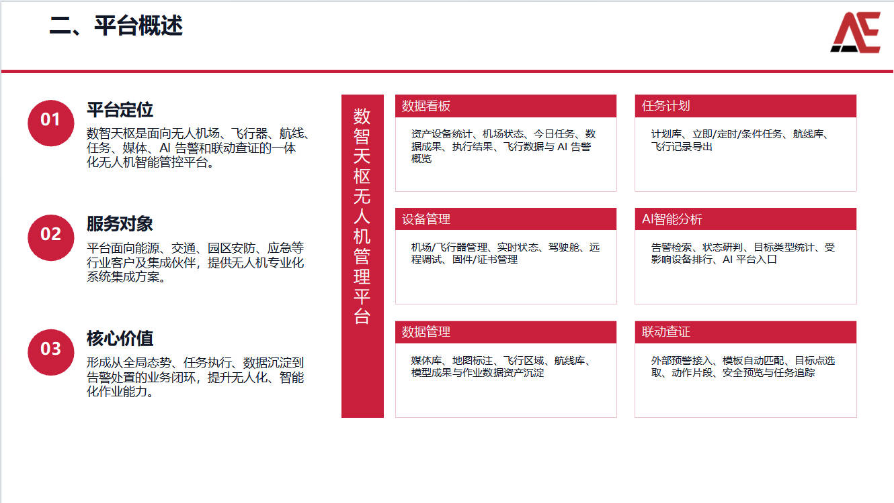

### 1.1 平台定位

数智天枢是面向无人机场、飞行器、航线、任务、媒体、AI 告警和联动查证的一体化无人机智能管控平台。

### 1.2 服务对象

平台面向能源、交通、园区安防、应急等行业客户及集成伙伴，提供无人机专业化系统集成方案。

### 1.3 核心价值

形成从全局态势、任务执行、数据沉淀到告警处置的业务闭环，提升无人化、智能化作业能力。

### 1.4 功能架构

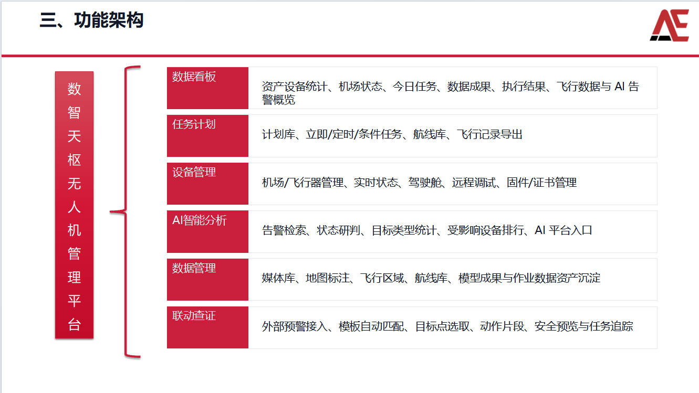

| 模块 | 能力范围 |
|---|---|
| **数据看板** | 资产设备统计、机场状态、今日任务、数据成果、执行结果、飞行数据与 AI 告警概览 |
| **任务计划** | 计划库、立即/定时/条件任务、航线库、飞行记录导出 |
| **设备管理** | 机场/飞行器管理、实时状态、驾驶舱、远程调试、固件/证书管理 |
| **AI 智能分析** | 告警检索、状态研判、目标类型统计、受影响设备排行、AI 平台入口 |
| **数据管理** | 媒体库、地图标注、飞行区域、航线库、模型成果与作业数据资产沉淀 |
| **联动查证** | 外部预警接入、模板自动匹配、目标点选取、动作片段、安全预览与任务追踪 |

---

## 二、功能介绍

### 2.1 数据看板

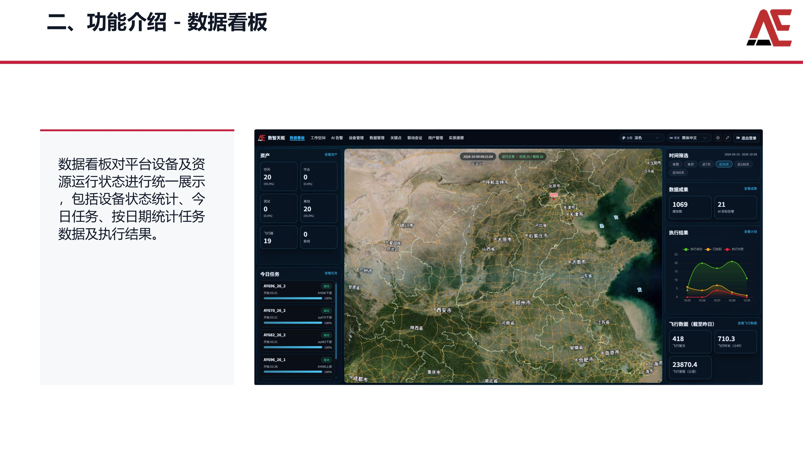

数据看板对平台设备及资源运行状态进行统一展示，包括设备状态统计、今日任务、按日期统计任务数据及执行结果。

**运行总览。** 左侧展示空闲、作业、调试、离线等资产状态及其数量占比，并同步呈现当日任务执行情况；中部设置地图区域，用于辅助查看相关地理信息。资产模块与设备管理页面关联，可进一步查看机场、飞行器及设备运行信息；今日任务模块与工作空间计划库关联，便于查询任务计划、执行状态及相关记录。

**时间筛选。** 提供本周、本月、近一周、近一月、近半年、近一年等时间范围，可用于查看相应周期内的数据成果与任务执行情况；飞行数据则统计截至昨日的累计架次、时长与里程。

**数据汇总。** 数据成果模块展示媒体数与 AI 目标告警数，并关联数据管理页面；执行结果模块按成功、失败、终止及其他状态统计任务情况，关联工作空间计划库；飞行数据模块展示截至昨日的飞行架次、飞行时长与飞行里程，关联每日飞行统计页面。

### 2.2 任务计划与航线库

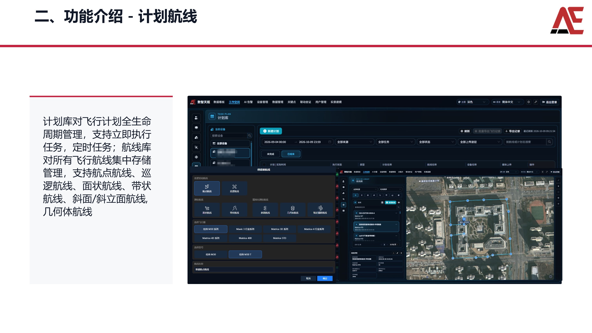

计划库对飞行计划全生命周期管理，支持立即执行任务，定时任务；航线库对所有飞行航线集中存储管理，支持航点航线、巡逻航线、测绘航线、面状航线、带状航线、斜面航线、几何体航线。

**航线管理：把飞行路线沉淀下来。** 无人机巡检要想长期稳定运行，第一步不是每次临时安排，而是先把成熟航线沉淀下来。客户可以根据巡检区域、重点点位、作业范围提前规划航线，并在平台中统一管理、编辑和调用。对于固定路线、高频巡检区域，航线一旦配置完成，后续任务执行时可以直接选择调用——过去是"人凭经验安排路线"，现在是"平台沉淀标准航线"。

**任务计划：从临时安排变成计划执行。** 平台支持围绕设备、航线、执行时间、任务状态等信息进行统一管理，整体流程可以概括为：

```
航线提前规划 → 任务按需选择 → 指令统一下发 → 飞行自动执行 → 平台实时查看
```

这样一来，无人机巡检就不再是临时性的人工操作，而是变成了标准化、任务化的执行流程——过去是"人找飞机去飞"，现在是"平台按任务调度飞机飞"。

**任务执行过程可看、可管、可追踪。** 任务执行过程中，管理人员可以统一查看无人机状态、任务进度、实时画面、当前位置等信息，带来三点直接价值：

- **看得见**——飞到哪、执行到哪，一目了然
- **管得住**——不是飞完才知道结果，而是在飞行过程中就能掌握状态
- **留得下**——任务过程可记录、可追踪、可复盘

**远程接管：让自动执行更安全。** 真正成熟的无人机巡检平台，不是简单地让飞机自动飞完，而是要做到能自动执行，也能必要时人工接管。平台支持在任务执行过程中，根据实时画面、飞行状态和现场情况进行远程干预与控制——**让系统执行标准动作，让人掌握关键控制权。**

### 2.3 设备管理

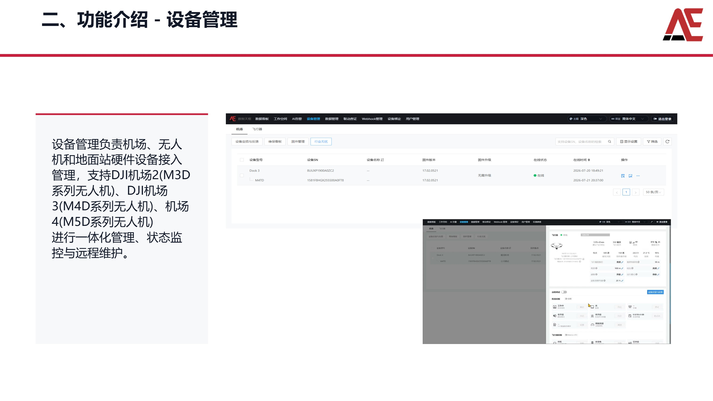

设备管理负责机场、无人机和地面站硬件设备接入管理，支持 DJI 机场 2（M3D 系列无人机）、DJI 机场 3（M4D 系列无人机）、机场 4（M5D 系列无人机）进行一体化管理、状态监控与远程维护。

设备管理页面集中展示机场与飞行器的在线状态、固件版本、运行时长、作业架次、电池及环境信息，并提供设备定损与反馈、维保看板、固件管理、行业无忧等运维入口。开展远程操控前，应结合设备状态、网络连接、飞行器电量和现场气象条件进行核验，确保设备具备作业条件。

### 2.4 数据管理

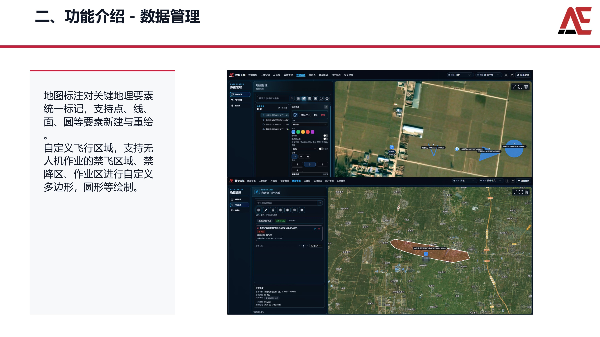

数据管理模块将飞行产出的媒体成果，与作业规划中创建的航线、地图标注、飞行区域集中管理，让零散数据转化为可检索、可复用的数字资产。

**存——媒体归档。** 媒体库将飞行采集的图片、视频、红外影像统一归集，按文件夹组织管理，照片、视频、压缩文件的个数与占用空间在顶部清晰展示。选中文件后可在线预览或下载，操作入口统一，无需额外工具。

**管——航线资产。** 航线库对项目工作区内的自动化飞行航线进行集中存储与分类组织，支持按机型过滤、按时间倒序排列，并集成作业类型分类筛选。每条航线可查看核心属性（机型、更新时间），可通过 KMZ 文件导入既有航线。

**标——地图标注。** 标注按目录归类管理，支持目录树检索与多级子目录组织；支持对点、线、面、圆四类空间几何要素的新建、编辑与重绘，可设置颜色样式并查看测量信息；支持 KML/KMZ 导入导出，方便与其他系统对接。

**画——飞行区域。** 支持自定义多边形与圆形的作业区、限飞区，以及禁降区，共五种区域类型。在地图上直接绘制区域边界，创建后可在左侧列表中查看区域详情（几何类型、更新时间、同步状态）；创建的区域可一键同步至设备，同步状态实时可查；还支持查询信号地图，辅助评估作业区域的链路覆盖情况。

### 2.5 AI 告警

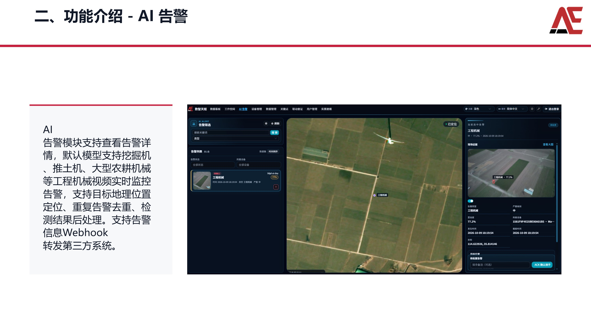

AI 告警的价值，不仅在于发现问题，更在于快速定位、及时处置、形成闭环。平台围绕 AI 告警管理、AI 推理协同、第三方 AI 集成三大能力，构建完整的 AI 告警业务链路。

**告警列表：状态清晰可视。** 平台将不同来源的 AI 告警结果集中汇聚、统一管理，支持新告警、已确认、误报、已关闭等不同阶段的状态管理，让每一条 AI 告警都可查看、可定位、可闭环。告警信息与地图定位能力相结合，每一条告警都可以关联设备信息、时间信息、位置信息，帮助用户快速定位异常发生区域及影响范围。

默认模型支持挖掘机、推土机、大型农耕机械等工程机械视频实时监控告警，支持目标地理位置定位、重复告警去重、检测结果后处理，并支持告警信息 Webhook 转发第三方系统。

**AI 推理协同：边界清晰，链路完整。** 在 AI 告警能力建设中，数智天枢负责承接和管理告警，推理引擎负责前端智能识别。推理引擎持续对无人机画面帧进行分析，将识别到的目标转化为结构化告警数据，通过回调、消息或接口方式推送至数智天枢后端服务；数智天枢接收到告警后，进一步完成告警落库、类型映射、状态流转、详情展示、地图定位，让算法侧的识别结果真正进入统一的业务管理体系。

当前平台以工程机械识别作为落地应用切入点，后续可结合客户现场需求定制人员识别、车辆识别、烟火识别、区域入侵、设备异常等更多类型的 AI 识别能力。

**第三方集成：标准帧数据开放。** 平台将无人机采集到的画面帧与设备信息、时间信息、位置信息、无人机姿态、载荷姿态统一封装，形成第三方 AI 可直接消费的数据基础，减少重复对接和格式适配成本。基于这些标准帧数据，第三方 AI 平台可以专注于目标识别和场景判断，并结合画面帧与载荷姿态信息，判断目标在画面中的位置并进一步辅助完成空间定位。

识别完成后，第三方 AI 平台可将结果回传至数智天枢，由平台统一完成告警生成、地图定位、状态流转、详情展示、闭环管理。**AI 平台负责识别目标，数智天枢负责封装数据、承接结果、定位告警、管理闭环。**

### 2.6 联动查证

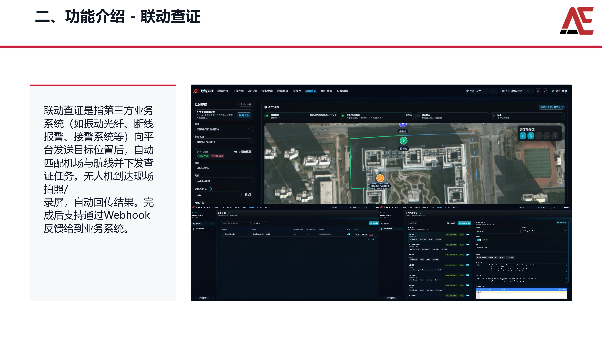

联动查证是指第三方业务系统（如振动光纤、断线报警、接警系统等）向平台发送目标位置后，自动匹配机场与航线并下发查证任务。无人机到达现场拍照/录屏，自动回传结果。完成后支持通过 Webhook 反馈给到业务系统。

**主要航线模板保障安全。** 联动查证不是报警后一键"盲飞"，而是先把报警位置纳入已有航线模板进行安全预览。航线模板可以关联既有航线、绑定可执行机场，并配置默认高度、默认速度、目标偏移上限等关键参数。系统会基于模板生成本次查证任务的预览信息，让工作人员在起飞前看到目标区域、飞行路径、起降位置和安全提示。

这意味着安全边界不再只依赖操作员临场经验，而是由航线、机场、速度、高度和偏移上限共同约束；一线人员接到报警后，可以先用几十秒完成任务复核，再进入飞行确认。**路径先可见，任务再确认，飞行更安全。**

**动作可定制。** 不同场景下，查证动作并不相同：园区周界可能更关注目标点拍照和短时悬停，油气管线可能需要沿线观察和重点区域复核，电力巡检则可能需要云台角度、变焦和影像采集配合。平台支持将这些动作沉淀为可管理的动作片段，并在任务执行时组合成动作计划。新增查证场景时，不必每次重新开发一条专用流程。

**支持自动化联动。** 平台会根据目标点匹配可用航线模板，计算目标点与航线的偏移情况，并结合机场在线状态、距离、电量等因素，选择更合适的执行机场。随后，任务进入预览、准备执行、确认复核、执行追踪和结果查看流程。响应链路从"人工找方案"变成"系统给方案、人工做确认"。

> 自动化联动并不是跳过安全控制，而是把模板匹配、机场选择、任务生成和状态追踪自动串起来，再把关键确认点留给工作人员复核。**自动化负责提速，确认机制负责守住安全边界。**

从"听见报警"到"看见现场"，客户获得的不是单个无人机功能，而是一条从报警触发、任务预览、飞行确认到结果追踪的查证闭环。

### 2.7 建模服务

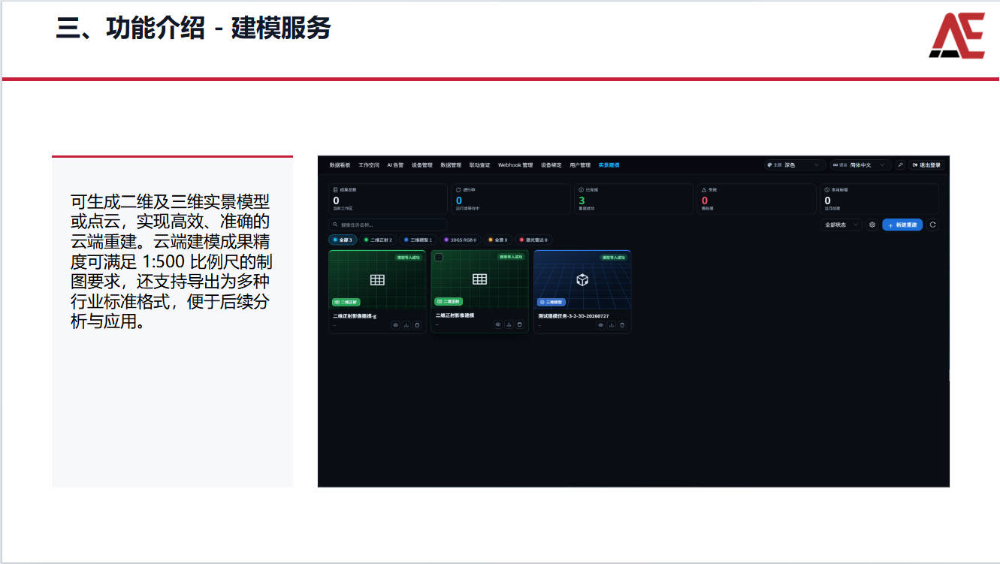

可生成二维及三维实景模型或点云，实现高效、准确的云端重建。云端建模成果精度可满足 1:500 比例尺的制图要求，还支持导出为多种行业标准格式，便于后续分析与应用。

---

## 三、系统特点

### 3.1 态势感知，远程运维

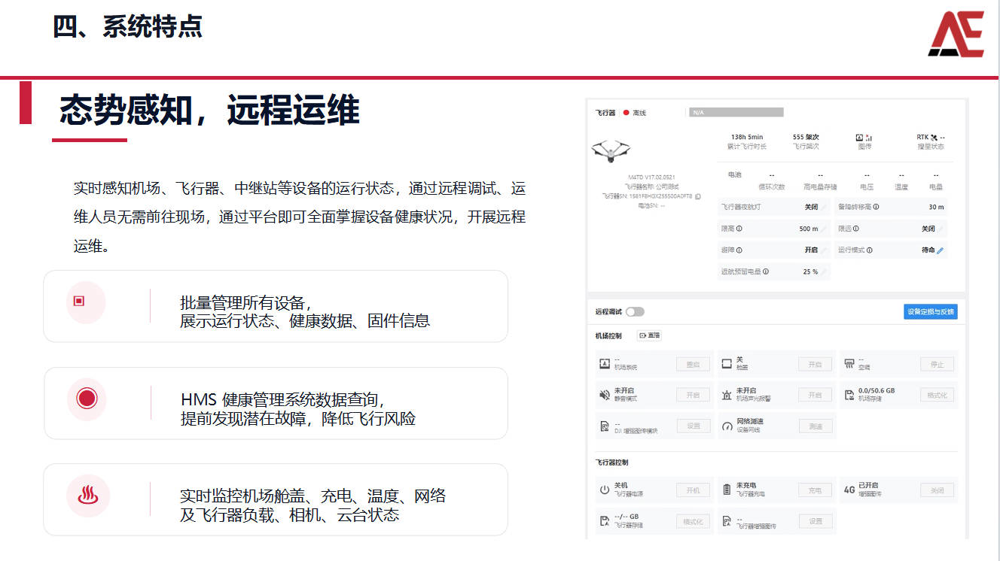

实时感知机场、飞行器、中继站等设备的运行状态，通过远程调试、运维人员无需前往现场，通过平台即可全面掌握设备健康状况，开展远程运维。

- 批量管理所有设备，展示运行状态、健康数据、固件信息
- HMS 健康管理系统数据查询，提前发现潜在故障，降低飞行风险
- 实时监控机场舱盖、充电、温度、网络及飞行器负载、相机、云台状态

### 3.2 精准规划，模板复用

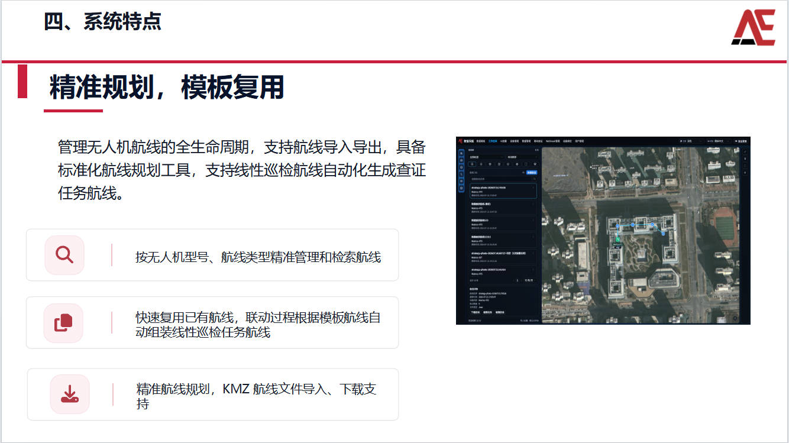

管理无人机航线的全生命周期，支持航线导入导出，具备标准化航线规划工具，支持线性巡检航线自动化生成查证任务航线。

- 按无人机型号、航线类型精准管理和检索航线
- 快速复用已有航线，联动过程根据模板航线自动组装线性巡检任务航线
- 精准航线规划，KMZ 航线文件导入、下载支持

### 3.3 智能巡检，无人值守

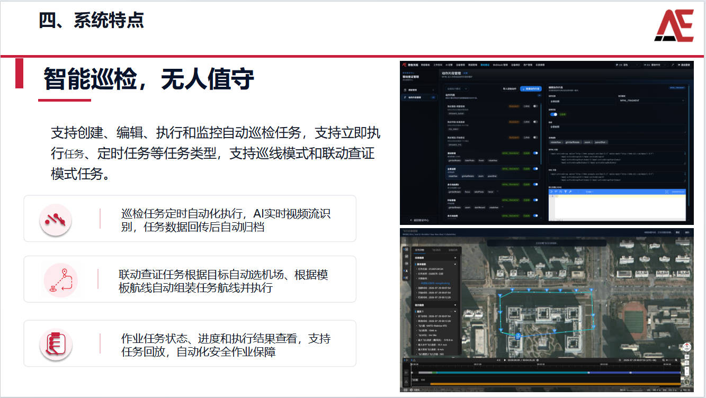

支持创建、编辑、执行和监控自动巡检任务，支持立即执行任务、定时任务等任务类型，支持巡线模式和联动查证模式任务。

- 巡检任务定时自动化执行，AI 实时视频流识别，任务数据回传后自动归档
- 联动查证任务根据目标自动选机场、根据模板航线自动组装任务航线并执行
- 作业任务状态、进度和执行结果查看，支持任务回放，自动化安全作业保障

### 3.4 飞行驾驶，精准操控

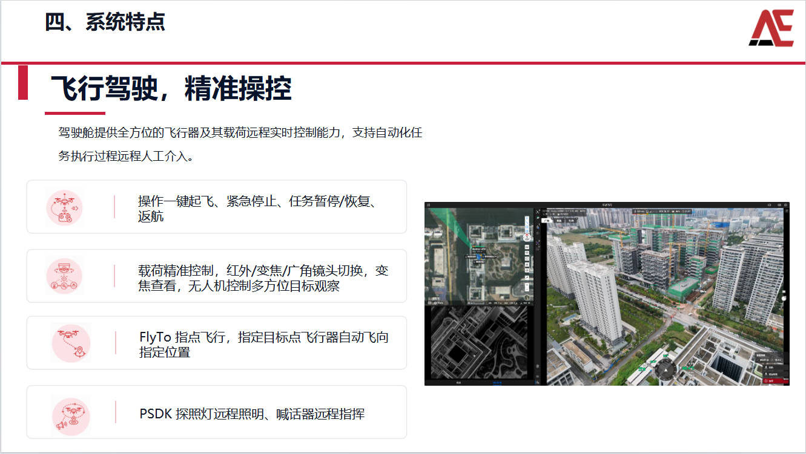

驾驶舱提供全方位的飞行器及其载荷远程实时控制能力，支持自动化任务执行过程远程人工介入。

- 操作一键起飞、紧急停止、任务暂停/恢复、返航
- 载荷精准控制，红外/变焦/广角镜头切换，变焦查看，无人机控制多方位目标观察
- FlyTo 指点飞行，指定目标点飞行器自动飞向指定位置
- PSDK 探照灯远程照明、喊话器远程指挥

虚拟座舱将地图、直播画面、飞行仪表和设备状态集中呈现，取得飞行控制权后，可结合实时画面通过鼠标和键盘控制飞行，并查看通信延迟、定位、电量、高度和速度等信息；多路直播页面支持 1、4、6 画面布局，集中监看多台设备。

### 3.5 线性巡检，秒级响应

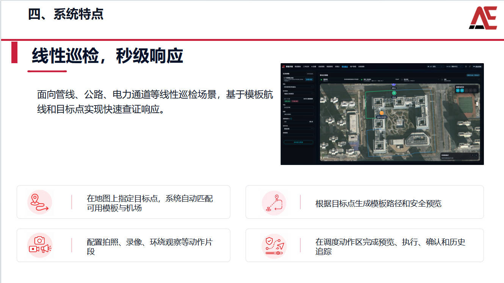

面向管线、公路、电力通道等线性巡检场景，基于模板航线和目标点实现快速查证响应。

- 在地图上指定目标点，系统自动匹配可用模板与机场
- 根据目标点生成模板路径和安全预览
- 配置拍照、录像、环绕观察等动作片段
- 在调度动作区完成预览、执行、确认和历史追踪

### 3.6 标准化接口，开放式集成

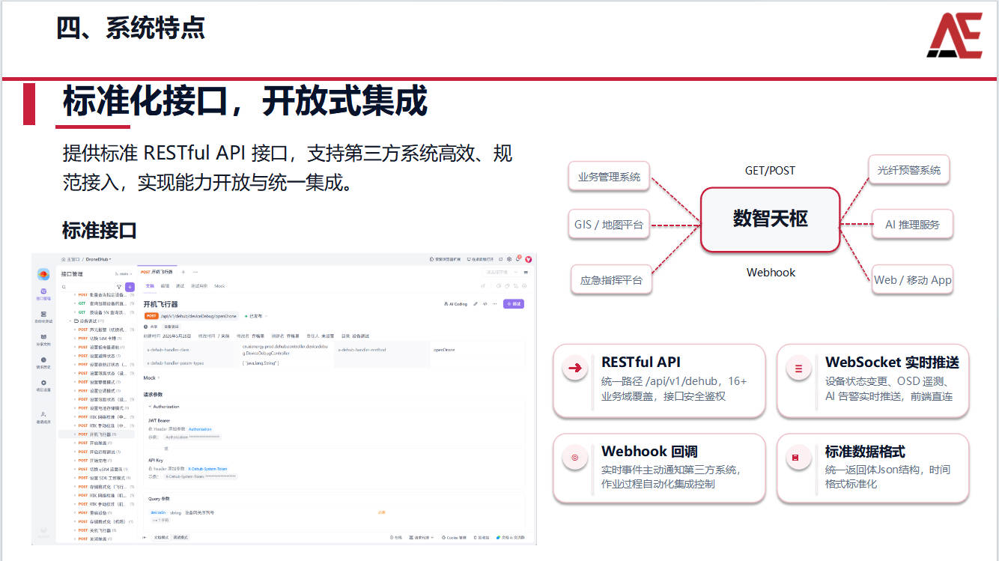

提供标准 RESTful API 接口，支持第三方系统高效、规范接入，实现能力开放与统一集成。

| 开放能力 | 说明 |
|---|---|
| **RESTful API** | 统一路径 `/api/v1/dehub/`，16+ 业务域覆盖，接口安全鉴权 |
| **WebSocket 实时推送** | 设备状态、OSD、遥测、AI 告警实时推送，前端直连 |
| **Webhook 回调** | 实时事件主动通知第三方系统，作业过程自动化集成控制 |
| **标准数据格式** | 统一返回体 Json 结构，时间格式标准化 |

鉴权方式支持两种：面向用户的 **JWT Bearer**（在 Header 添加 `Authorization`），以及面向系统集成的 **System Token**（在 Header 添加 `X-Debhub-System-Token`）。

---

## 四、技术架构

### 4.1 项目概览

数智天枢是基于 DJI FlightHub SDK（KOC3 v3.3.5）的无人机管理与作业调度平台，提供设备管理、航线规划、实时直播、AI 推理、数据归档等核心能力。

### 4.2 技术栈

#### 后端（gnsz-dehub-svr）

- **框架**：Spring Boot 3.5.16 + Java 17
- **数据库**：PostgreSQL + PostGIS（空间数据）
- **迁移**：Flyway
- **消息队列**：gRPC + WebSocket（实时推送）
- **对象存储**：AWS S3 SDK v2（兼容 MinIO）
- **AI 推理**：gRPC 调用自研 gnsz-ai-infer2 引擎（YOLOv12 + TensorRT）
- **直播推流**：DJI DRTC SDK 0.27.0.139
- **构建工具**：Maven Wrapper 3.9.11

#### 前端（gnsz-dehub-client）

- **框架**：Vue 3.5.13 + TypeScript 5.8.3
- **UI 组件**：Ant Design Vue 4.2.6
- **地图引擎**：Mars3D（基于 Cesium 1.117.0）
- **状态管理**：Pinia 2.3.1
- **构建工具**：Vite 6.2.2 + pnpm 10.12.2
- **包管理器**：pnpm（node >= 22.0.0）

#### AI 推理引擎（gnsz-ai-infer2）

- **深度学习框架**：TensorRT + YOLOv12
- **协议**：gRPC（frame_egress.proto）
- **能力**：目标检测、模型管理、手动分析、SEI（补充增强信息）

### 4.3 后端分层架构

```
cn.aienergy.prod.dehub/
├── Application.java          # 主入口
├── domain/                   # 领域层（核心业务逻辑）
│   ├── device/              # 设备域（机场、飞行器、挂载）
│   ├── flighttask/          # 航线任务域
│   ├── media/               # 媒体文件域
│   ├── realtime/            # 实时数据域（WebSocket 推送）
│   └── terra/               # 大疆智图建模域
├── infrastructure/           # 基础设施层
│   ├── repository/          # 数据持久化
│   ├── objectstorage/       # 对象存储适配
│   └── aiinfer/             # AI 推理 gRPC 客户端
├── integration/             # 第三方集成
│   ├── djigate/             # DJI SDK 网关适配器
│   └── webhook/             # 外部 Webhook 集成
├── interfaces/              # 接口层
│   ├── rest/                # REST API 控制器
│   └── websocket/           # WebSocket 端点
├── sdk/                     # DJI SDK 管理
│   ├── listener/            # 平台事件监听器
│   └── invoker/             # SDK 命令调用器
└── realtime/                # 实时数据管道
    ├── lane/                # 分车道消费（灰度、正常、气象）
    └── consumer/            # 消费组并行处理
```

### 4.4 前端模块化结构

```
src/
├── views/                   # 页面组件
│   ├── device/             # 设备管理
│   ├── task/               # 任务管理
│   ├── media/              # 媒体中心
│   ├── live/               # 实时直播
│   └── terra/              # 建模任务
├── api/                    # API 请求层
├── stores/                 # Pinia 状态管理
├── router/                 # 路由配置
├── components/             # 通用组件
│   ├── map/               # 地图相关（基于 Mars3D）
│   ├── media/             # 媒体播放器
│   └── charts/            # 数据可视化
└── auth/                   # 认证模块（RBAC）
```

### 4.5 数据流架构

**实时数据管道**

```
DJI SDK 平台事件
    ↓
DeviceStatusListener (初筛)
    ↓
RealtimeEventProducer (分车道)
    ├─→ 灰度车道 (gray entry)
    ├─→ 正常车道 (default)
    └─→ 气象车道 (meteorological)
    ↓
消费组并行处理 (8 线程)
    ↓
WebSocket 广播 (/realtime/device-status)
```

**AI 推理集成**

```
直播帧流 (DRTC)
    ↓
帧提取器 (按帧率采样)
    ↓
gRPC → gnsz-ai-infer2
    ↓
检测结果 + SEI 元数据
    ↓
WebSocket 推送前端 (/aiInfer/sei/realtime)
```

**媒体上传与存储**

```
飞行器采集
    ↓
DJI Cloud (临时存储)
    ↓
Webhook 回调触发下载
    ↓
MinIO/S3 归档
    ↓
PostgreSQL 元数据索引
```

### 4.6 部署架构

**单机部署**

- **存储**：PostgreSQL + MinIO
- **网络**：需信任 DJI 根证书（私有化部署时）
- **端口暴露**：
  - 8099：后端 API
  - 8443：DRTC 直播流（需防火墙开放）

包含 Maven 依赖镜像、前端 node_modules、Docker 镜像、测试签名密钥。生产环境的服务器配置与容量规划见[第八章 运行环境](#八运行环境)。

### 4.7 外部依赖

#### DJI FlightHub SDK（KOC3）

- **版本**：3.3.5-20260921
- **集成方式**：jar 包本地依赖 + Maven 发布到私有仓库
- **关键模块**：
  - DeviceManagement（设备管理）
  - WaylineManagement（航线管理）
  - MediaManagement（媒体文件）
  - LiveManagement（直播推流）
  - TerraManagement（智图建模）

#### 关键限制

- 诊断模块（DiagnosisManagementModule）未开放，404 响应
- DRTC SDK 需手动注入前端（版本对不齐会导致 CORS 失败）
- 舱盖等 GPIO 状态需监听器优先（HTTP 轮询会被陈旧值覆盖）

### 4.8 安全机制

- **认证**：JWT + RBAC 权限模型
- **授权**：角色-权限映射（前后端双重校验）
- **密钥管理**：
  - DJI App Key/Secret 环境变量注入
  - License 本地 RSA 签名验证
  - MinIO Access Key/Secret 配置文件隔离

---

## 五、作业场景

### 5.1 油气管网 / 长输管线

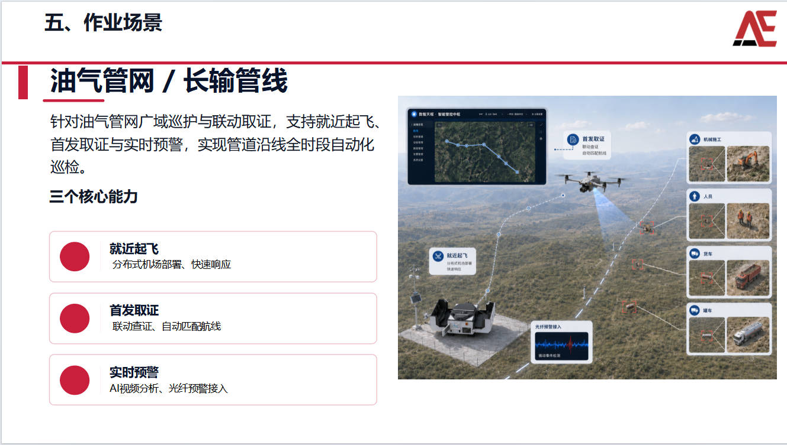

针对油气管网广域巡护与联动取证，支持就近起飞、首发取证与实时预警，实现管道沿线全时段自动化巡检。

**三个核心能力**

- **就近起飞**——分布式机场部署、快速响应
- **首发取证**——联动查证、自动匹配航线
- **实时预警**——AI 视频分析、光纤预警接入

### 5.2 输电线路 / 电力巡检

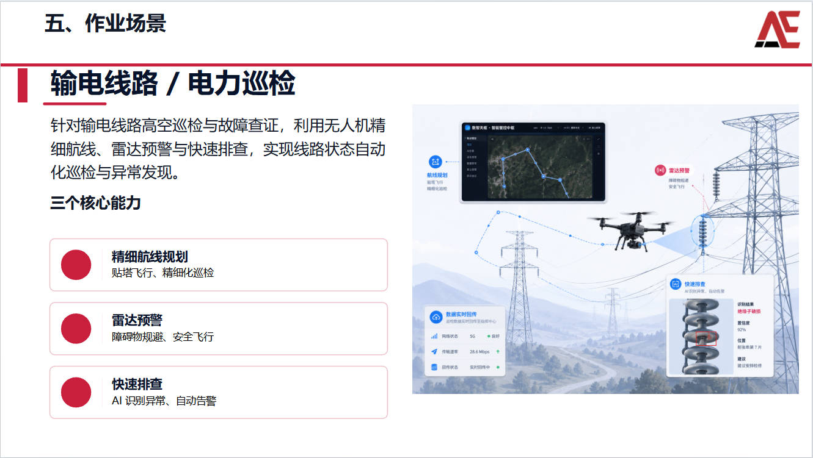

针对输电线路高空巡检与故障查证，利用无人机精细航线、雷达预警与快速排查，实现线路状态自动化巡检与异常发现。

**三个核心能力**

- **精细航线规划**——贴塔飞行、精细化巡检
- **雷达预警**——障碍物规避、安全飞行
- **快速排查**——AI 识别异常、自动告警

### 5.3 安防 · 智慧园区

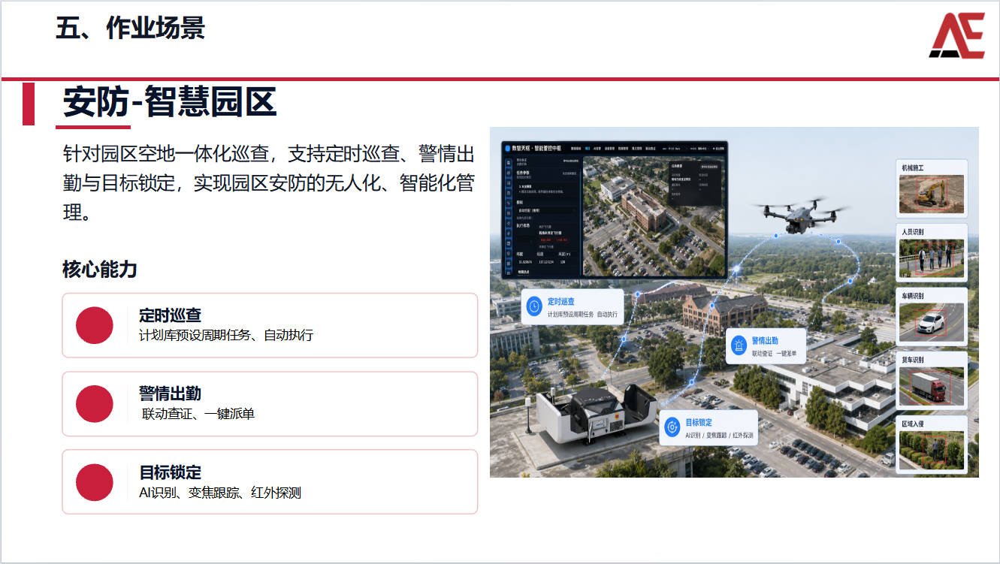

针对园区空地一体化巡查，支持定时巡查、警情出勤与目标锁定，实现园区安防的无人化、智能化管理。

**核心能力**

- **定时巡查**——计划库预设周期任务、自动执行
- **警情出勤**——联动查证、一键派单
- **目标锁定**——AI 识别、变焦跟踪、红外探测

### 5.4 应急救援 / 抢险

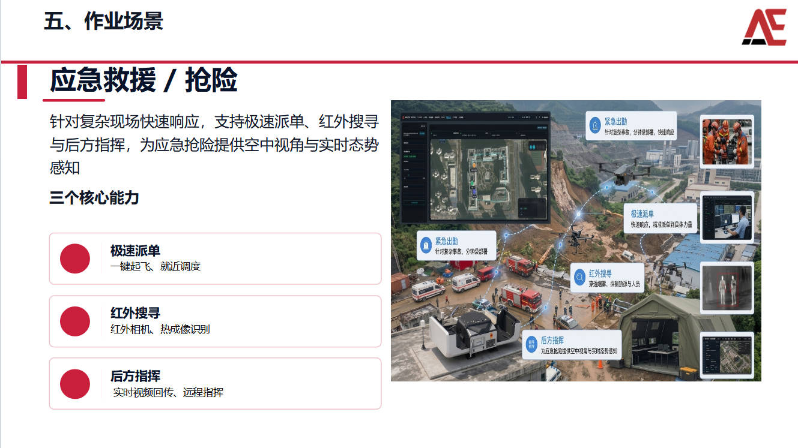

针对复杂现场快速响应，支持极速派单、红外搜寻与后方指挥，为应急抢险提供空中视角与实时态势感知。

**三个核心能力**

- **极速派单**——一键起飞、就近调度
- **红外搜寻**——红外相机、热成像识别
- **后方指挥**——实时视频回传、远程指挥

---

## 六、产品版本

### 6.1 版本特点

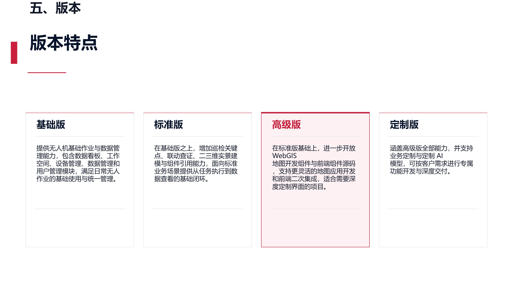

| 版本 | 说明 |
|---|---|
| **基础版** | 提供无人机基础作业与数据管理能力，包含数据看板、工作空间、设备管理、数据管理和用户管理模块，满足日常无人作业的基础使用与统一管理。 |
| **标准版** | 在基础版之上，增加巡检关键点、联动查证、二三维实景建模与组件引用能力，面向标准业务场景提供从任务执行到数据查看的基础闭环。 |
| **高级版** | 在标准版基础上，进一步开放 WebGIS 地图开发组件与前端组件源码，支持更灵活的地图应用开发和前端二次集成，适合需要深度定制界面的项目。 |
| **定制版** | 涵盖高级版全部能力，并支持业务定制与定制 AI 模型，可按客户需求进行专属功能开发与深度交付。 |

### 6.2 能力对比

| 能力 | 基础版 | 标准版 | 高级版 | 定制版 |
|---|:---:|:---:|:---:|:---:|
| 数据看板 | ● | ● | ● | ● |
| 工作空间 | ● | ● | ● | ● |
| 设备管理 | ● | ● | ● | ● |
| 数据管理 | ● | ● | ● | ● |
| 用户管理 | ● | ● | ● | ● |
| 巡检关键点 | — | ● | ● | ● |
| 联动查证 | — | ● | ● | ● |
| 实景建模 · 二三维建模 | — | ● | ● | ● |
| 前端组件 · 组件引用 | — | ● | ● | ● |
| 前端组件 · WebGIS 地图开发 | — | — | ● | ● |
| 前端组件 · 前端组件源码 | — | — | ● | ● |
| 功能定制 · 业务定制 | — | — | — | ● |
| AIE 推理平台 · 定制模型 | — | — | — | ● |
| 前端组件 · WebGIS 开发 | — | — | ● | ● |
| 前端组件 · 组件引用 | — | ● | ● | ● |
| 前端组件 · 组件源码 | — | — | ● | ● |

> ● 包含　— 不含

---

## 七、交付与服务

### 7.1 产品交付物

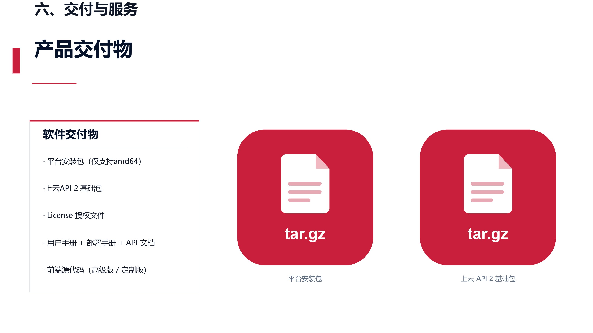

**软件交付物**

- 平台安装包（仅支持 amd64）
- 上云 API 2 基础包
- License 授权文件
- 用户手册 + 部署手册 + API 文档
- 前端源代码（高级版 / 定制版）

交付形态为两个 `tar.gz`：平台安装包、上云 API 2 基础包。

---

## 八、运行环境


**服务器（必配）**

| 项目 | 要求 |
|---|---|
| CPU | 8 核 |
| 内存 | 64 GB |
| 数据盘 | 2000 GB（SSD） |
| 操作系统 | Ubuntu Server 22.04 LTS |
| 容器环境 | Docker 24.0.7 + Compose 2.21.0 |

**网络与容量**

| 项目 | 要求 |
|---|---|
| 机场接入 | 每台机场不低于 100 Mbps |
| 直播带宽 | 每路直播约 5 Mbps，按机场数递增 |
| 公网部署 | 需固定公网 IP，上下行对等 100 Mbps |
| 容量参考 | 8C / 32G ≈ 20 台机场同时在线 |
| 扩容建议 | 50 台规模建议 16 核 / 64 GB |

**选配与客户端**

| 项目 | 要求 |
|---|---|
| 三维建模（选配） | 需独立 GPU 服务器 |
| 显卡要求（选配） | NVIDIA 算力 ≥ 6.1，显存 ≥ 4 GB |
| 驱动要求 | CUDA ≥ 12.8 |
| 客户端 | Chrome 120 及以上版本 |
| 设备固件 | 机场与飞行器固件版本需支持上云 API 2 |

---

## 结语

数智天枢把无人机作业的设备、任务、数据与告警统一到一个平台：数据看板呈现运行情况，工作空间与计划库负责任务下发和执行，数据管理负责成果沉淀与复用，AI 告警与联动查证负责把发现的问题转化为可执行的查证任务。

平台采用源代码开放交付，提供标准 RESTful API、WebSocket 实时推送与 Webhook 回调能力，支持私有化部署与二次开发，适配多元 AI 算法接入。

> **数智天枢 · 期待与您携手共创**

---

**西安国能数智科技有限公司**　公司官网：<http://www.ai-energy.cn>

**GitHub:** https://github.com/xiangnsz/dehub

**联系人：**
张经理（18592056057）  杨经理（18592058710）  樊经理（18629316031）
